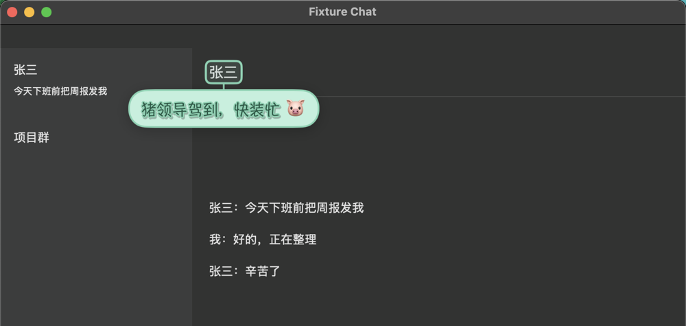

# LifeNarrator

**English** | [简体中文](README.zh-CN.md)

> Your life, now with a narrator.

LifeNarrator is a lightweight macOS menu bar app that watches what is on your screen and pops up small, cute narration bubbles on the active window: colorful hand-drawn fonts, a few emoji, and a lot of attitude.

- Open DingTalk → *"Back to work again! 😩"*
- Open a chat with your boss → their name gets boxed with *"Pig Boss 🐷"*
- Tell it *"I hate Google"* once → every time you open Google, it grumbles for you.



> **Status:** v0.1 preview. Download `LifeNarrator.zip` from [Releases](https://github.com/zygs1083-dotcom/LifeNarrator/releases).

## Features

- **Real-time, on the active window**: bubbles appear next to the window you are using, or right on the text they are talking about, and follow the window when it moves.
- **Your own rules**: a global input box (hotkey) where you describe what you love or hate in plain words, e.g. "I hate meetings", "Zhang San is my boss". LifeNarrator turns them into rules and reacts when they come up on screen.
- **Fully customizable bubbles**: display time, fade and pop animations, how many bubbles at once, size, shape (bubble, cloud, speech balloon, sticker, sticky note), art text effects, color themes, emoji density, persona (snarky, sweet, chuunibyou).
- **Works without any AI model**: a built-in quip pack covers popular apps and websites.
- **Bring your own model**: download the built-in engine after install, or connect any OpenAI-compatible API or local server (Ollama, LM Studio). Fast decisions use [System One](https://docs.typesafe.ai/concepts/system-one) models such as Jev or open alternatives through the `/v1/systemone` API.
- **Bilingual**: English and Simplified Chinese UI and quips.

## Lightweight by design

- Event-driven: when nothing changes on screen, it does nothing.
- Reads text through the Accessibility API first. Screen capture and on-device OCR are used only when needed, and skipped when the window has not changed.
- Quips are generated ahead of time and cached, so bubbles appear instantly without waiting for a model.
- No bundled models or fonts. It uses the cute fonts that already ship with macOS.
- Measured on an M1 Max: 22 MB of memory and 0% CPU when idle. The built-in model (Qwen3.5-4B, a 2.7 GB download) is loaded only while it writes rules and quips, and unloaded after 5 idle minutes.

## Privacy

Everything runs on your Mac by default. Screen text is never logged or saved to disk, and password fields are never read. If you connect a cloud API, the app tells you clearly that screen text will be sent to it.

## Requirements

- macOS 14 Sonoma or later
- Apple silicon
- Accessibility permission (required) and Screen Recording permission (optional, enables OCR for apps that do not expose their text)

## Install and use

1. Download `LifeNarrator.zip` from [Releases](https://github.com/zygs1083-dotcom/LifeNarrator/releases), unzip it and move `LifeNarrator.app` to Applications.
2. The app is not signed with an Apple Developer ID. On macOS 14, right-click it and choose **Open**. On macOS 15, open it once, then go to **System Settings → Privacy & Security** and click **Open Anyway**.
3. Pick a model option in the welcome window and grant Accessibility permission.
4. Press **⌥⇧N** (or use the menu bar icon) and type something like "I hate Google" or "Zhang San is my boss". **⌥⇧P** pauses the narrator.

LifeNarrator lives in the menu bar and has no Dock icon. When the menu bar is full, macOS hides icons that do not fit (especially on MacBooks with a notch). Open LifeNarrator again from Applications or Spotlight to bring up its settings, where the About tab also has a Quit button.

Releases are signed with the same self-signed certificate from v0.1.4 on, so macOS keeps the Accessibility permission across updates. When updating from an older version, grant it once more: if bubbles stop appearing, remove LifeNarrator from **Privacy & Security → Accessibility** and add it again.

## Building from source

```sh
swift build
scripts/bundle.sh   # needs Xcode; builds dist/LifeNarrator.app and dist/LifeNarrator.zip
```

## License

[MIT](LICENSE)
